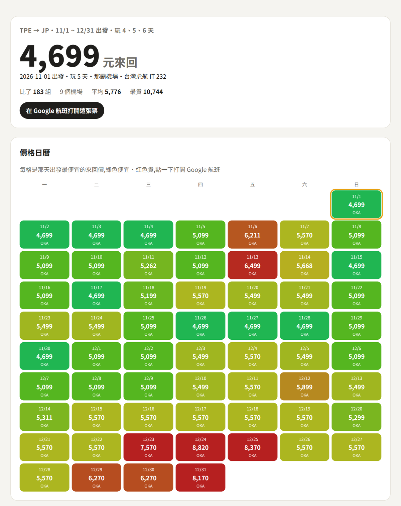

# flight-scan:讓 Claude 幫你掃機票

一個給 [Claude Code](https://claude.com/claude-code) 用的 skill。跟 Claude 說「兩個月內想去日本玩 4 到 6 天,幫我找最便宜的來回」,
它會透過 [SerpApi](https://serpapi.com) 讀 Google 航班,把**每一天出發 × 玩幾天 × 日本所有機場**一次比完,交給你一頁價格日曆報表。



以前找機票是一個日期一個日期換著查;現在一句話,183 種組合一口氣比完。

- **最便宜的來回**:整段日期 × 幾種天數 × 整個國家的機場,排出前 10 名和每個機場的最低價
- **預算內能飛哪**:預算 8,000,列出所有飛得到的城市
- **該不該現在買**:Google 的價格水準(偏低 / 一般 / 偏高)、平常區間、近兩個月的價格紀錄
- **挑對日子**:同一班飛機,哪天出發最便宜、哪天最貴、差多少
- **一頁報表**:價格日曆(綠便宜、紅貴)、前 10 名、各機場長條,每一格點了直接打開 Google 航班

查過的條件會存下來,同樣的問題再問不扣額度。只查不訂,要訂票就點連結自己去 Google 航班訂。

## 安裝

需要:Claude Code、Python 3.9 以上(不用裝任何套件)、一把 SerpApi 金鑰(免費方案每月 250 次)。

```bash
git clone https://github.com/ShabiSung/flight-scan ~/.claude/skills/flight-scan
```

Windows 的 skills 目錄是 `C:\Users\<你的帳號>\.claude\skills\`。

金鑰:到 https://serpapi.com/users/sign_up 免費註冊,登入後在 Dashboard 複製「Your Private API Key」,
存成 `~/.claude/skills/flight-scan/.env`,內容一行:

```
SERPAPI_KEY=你的金鑰
```

或直接把金鑰貼給 Claude,叫它幫你存。

## 使用

在 Claude Code 裡直接說:

> 兩個月內想去日本玩 4 到 6 天,幫我找最便宜的來回,日本所有機場都算

Claude 會先算要查幾次、還剩幾次額度,你說好才開始。查完接著問:

> 預算 8,000,能飛日本哪些城市?
>
> 這張票現在算便宜還是貴?給我價格紀錄
>
> 這一班飛東京的飛機,哪天出發最便宜、哪天最貴?
>
> 把結果整理成一頁報表給我

不只日本:韓國、泰國、越南、新加坡、美國…都有內建代號,出發地也可以換成高雄、松山或任何機場。

也可以自己跑:

```bash
python ~/.claude/skills/flight-scan/scripts/flights.py account
python ~/.claude/skills/flight-scan/scripts/flights.py grid --from TPE --to JP --start 2026-11-01 --end 2026-12-31 --days 4,5,6 --dry-run
python ~/.claude/skills/flight-scan/scripts/flights.py --help
```

## 授權

- Apache-2.0,詳見 `LICENSE`、`NOTICE`。
- 票價資料來自 Google 航班(透過 SerpApi,用你自己的金鑰與額度)。票價隨時在變,訂票前以 Google 航班當下為準。

## 資料夾

```
SKILL.md          Claude 讀的主說明(流程、額度規則)
scripts/flights.py  查詢、整理、報表(只用 Python 標準函式庫)
references/       常用說法對照、SerpApi 參數與地點代號
docs/             README 圖片
```

---

**English:** A Claude Code skill that scans Google Flights through SerpApi across every departure date in a range ×
several trip lengths × every airport in a country, finds the cheapest round trip, and writes a one-page HTML price
calendar. It also answers "what can I fly to under my budget", "is this fare low or high right now" (Google price
history) and "which day is cheapest for this exact flight". Python standard library only; results are cached so
repeated questions cost no API credits. Docs are in Traditional Chinese. Licensed under Apache-2.0.
